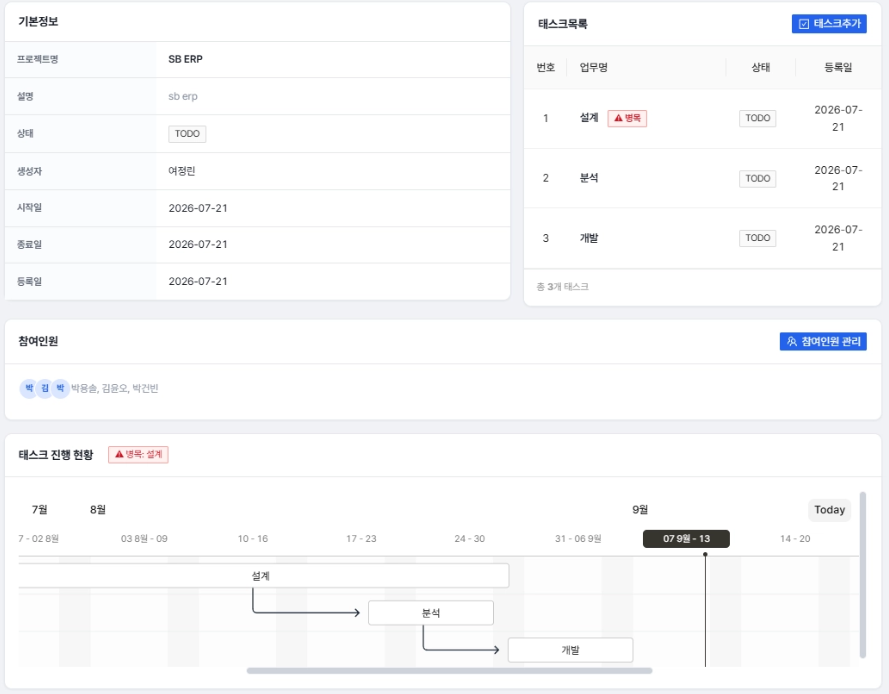
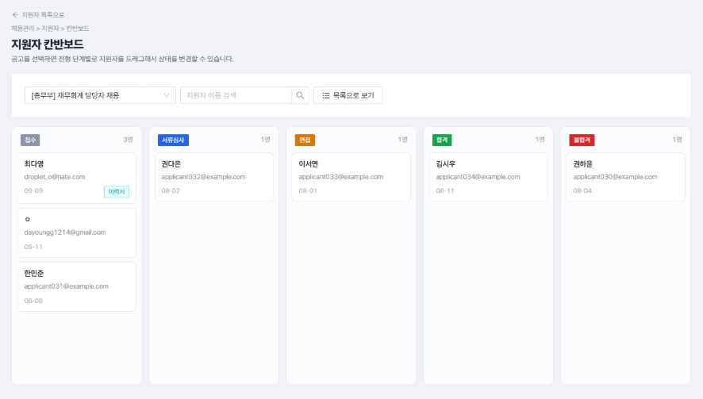
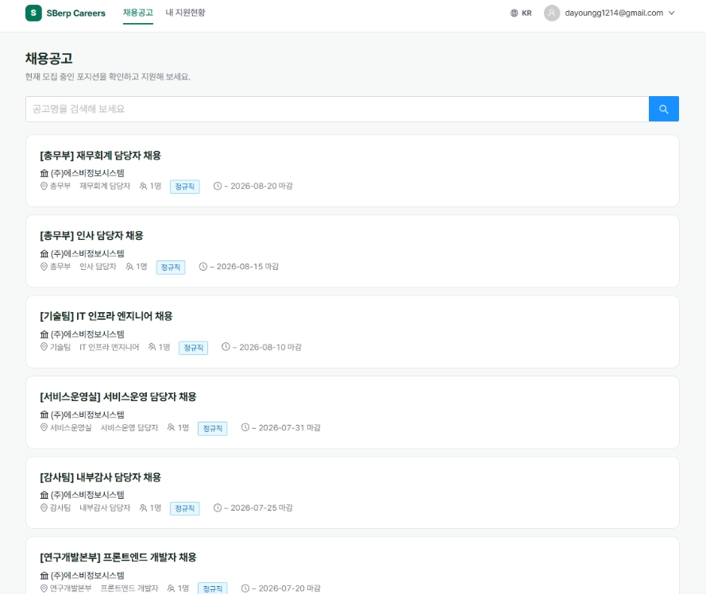

# SBerp v3 — 프로젝트·태스크·공지 관리 & 채용관리 모듈 (REST API 전환 + AI 채용 매칭)

6인 팀으로 진행한 사내 ERP 프로젝트(spring-breeze) v3(최종) 버전 중, 제가 담당한 프로젝트/태스크 모듈의 REST API 전환과 신규 개발한 채용관리(RAG 기반 AI 매칭) 모듈을 정리한 저장소입니다.

팀 전체 코드 → https://github.com/yoonguri988/spring-breeze-erp

## 📌 프로젝트 개요

| 항목 | 내용 |
|---|---|
| 프로젝트명 | SBerp v3 (spring-breeze-erp-v3) |
| 팀명 | Spring Breeze |
| 개발 기간 | 2026.08.01~2026.08.28 |
| 팀 인원 | 4명 |
| 도메인 | https://cdy-sberp.duckdns.org / https://cdy-sberp.duckdns.org/careers |
| 신규 기능 | REST API 전환, Critical Path 탐색기, 채용관리(RAG), 소셜 로그인 |
| 대상 사용자 | 중소 규모 기업 관리자 / 임직원 / 비회원용 소셜 |
| 담당 모듈 | 프로젝트 · 태스크 · 공지(REST 전환) + 채용관리 신규 구축 |
| v2 대비 추가 범위 | MVC → REST API 전환, JWT+Redis 인증, React SPA 전환, 채용관리(Recruit·Applicant·Resume·RAG) 신규 |

## 🛠 기술 스택

<table>
<tr>
<td valign="top" width="50%">

**Backend**

> 신규 기능(채용관리)은 JPA, 기존 모듈(프로젝트/태스크)은 MyBatis 유지 → RestController 기반 API로 전환
> 세션 로그인 + JWT 필터 하이브리드 구조, Redis로 토큰 관리

**Frontend**

> Thymeleaf 화면을 React 페이지/모달로 1:1 전환, `@hello-pangea/dnd`로 칸반보드 드래그앤드롭

**Database**

</td>
<td valign="top" width="50%">

**External API / AI**

> GPT: 이력서-공고 적합도(fit_score) 평가
> 소셜 로그인 3종: 지원자용 별도 OAuth2 플로우

**Infra**

**협업 도구**

</td>
</tr>
</table>

## Features

### 프로젝트/태스크/공지 모듈 REST API 전환
기존 Thymeleaf MVC 컨트롤러를 RestController 기반 API로 전환했습니다.
- Request/Response DTO 분리, comId/empId는 서버에서 JWT로 세팅(`@Schema(hidden=true)`)
- `@Valid` 검증 누락분 전체 추가, 서버 세팅 필드는 `@NotNull` 제거(검증 시점 이슈 대응)
- Swagger UI로 API 문서 자동화
- 컨트롤러별 `@CrossOrigin(origins="*")` 제거, 중앙화된 CORS 설정으로 통일

### 핵심 병목(Critical Path) 탐색기
트리 구조(단일 부모, fan-in 없음) 특성상 일반 CPM 대신, "본인은 지연됐지만 부모는 지연되지 않은 태스크"를 지연의 시발점으로 판별하는 방식으로 구현했습니다.
- `TaskDependencyServiceImpl.findCriticalPath`
- 기존 Gantt 조회(`fetchGantt`)와 동일한 Request/Success/Failure 패턴으로 `fetchCriticalPath` 추가
- Gantt 차트에서 병목 태스크를 `custom_class`(`sb-bottleneck-bar`)로 강조 표시

### 채용관리 — 채용공고/지원자 관리
채용공고 등록부터 지원자 접수·전형 관리까지 담당자용 관리 기능입니다.
- 채용공고(Recruit) CRUD, 지원자(Applicant) 상태 관리(RECEIVED → SCREENING → INTERVIEW → HIRED/REJECTED)
- 지원자 목록(빠른 단건 상태 변경)과 칸반보드(파이프라인 전체 조망) 두 화면 병행 제공
- 대시보드(집계 카운트 기반)

### 지원자 공개 페이지 (비로그인 사용자)
채용공고는 회사 구분 없이 잡코리아 방식으로 전체 공개하고, 지원자는 소셜 로그인만으로 지원 현황을 조회할 수 있게 구현했습니다.
- 채용공고 목록/상세 공개 조회 (비인증)
- 이력서 업로드 및 지원서 제출
- 카카오/네이버/구글 소셜 로그인으로 본인 지원 내역·전형 상태 조회
- 담당자 검토 시작(RECEIVED 이후) 시 지원 취소/수정/이력서 재업로드 차단 (IDOR 방지 포함 소유권 검증)

### RAG 기반 이력서 분석 및 적합도 평가
이력서 파일을 업로드하면 AI가 분석해 공고와의 적합도를 평가합니다.
- 이력서 청킹 + 임베딩 저장 (Oracle 18c XE는 VECTOR 타입 미지원 → JSON/CLOB 저장, Java에서 코사인 유사도 계산)
- 적합도 점수(fit_score)는 GPT 프롬프트 직접 평가 방식으로 산출 (임베딩은 지원자 검색/키워드 조회용으로 별도 활용)
- 테이블 구조: `recruit` – `applicant` – `resume` – `resume_chunk` (1:N)

## 🔭 향후 개선 방향

| 구분 | 현재 (AS-IS) | 개선 방향 (TO-BE) |
|---|---|---|
| 이력서 검색 성능 | 공고별 이력서 청크를 전량 메모리에 올려 유사도를 계산 | 벡터 DB 도입으로 지원자가 늘어나도 검색 속도 유지 |
| AI 판단 근거 | 적합도 점수만 노출되고, 산출 근거가 화면에 드러나지 않음 | 근거 문장을 함께 노출해 채용 담당자가 점수를 검증할 수 있게 개선 |
| 지원자 정보 통합 관리 | 지원자별 정보와 지원 이력을 따로 확인해야 해 관리가 번거로움 | 지원자 정보와 지원 이력을 한곳에서 관리해 필요한 정보를 빠르게 확인 |
| 채용 상태 추적 | 지원자 상태를 바꿔도 누가 언제 바꿨는지 이력이 남지 않음 | 상태 전이 로그를 남기고 지원자에게 알림을 보내 문의를 줄임 |

## 📁 주요 설정 / 기술 포인트

- MyBatis(기존 모듈) + Spring Data JPA(신규 모듈) 하이브리드 구조, 단일 DataSource 공유
- Spring Security 세션 로그인 + JWT 필터 하이브리드(`/api/**`는 stateless)
- Oracle 18c 재귀 CTE, `START WITH...CONNECT BY`, `SELECT FOR UPDATE WAIT` 활용

## Troubleshooting

- **인가 역할 오분류**: `SecurityUtil`의 `isRoot()`/`isAdminOrRoot()` 분리로 `ROLE_ADMIN`이 전체 회사 프로젝트를 조회하던 문제 해결
- **IDOR 취약점**: 이력서 업로드/지원 취소·수정 API에 provider+providerId 소유권 검증 추가
- **지원 정보 수정 버그**: 이력서 재업로드 버튼이 지원 상태와 무관하게 노출되던 것을 `RECEIVED` 상태에서만 노출되도록 통일
- **회사 필터링 누락 버그**: 프로젝트 검색 시 검색 조건과 `com_id` 필터가 함께 쓰이면 다른 회사 프로젝트가 노출되는 문제 확인 (원인 조사 중)

## Related Repositories
- v1 (Spring MVC + JSP): https://github.com/dndkd97/SB_ERP_V1  
- v2 (Spring Boot + 태스크 의존성/AI 리스크 분석): https://github.com/dndkd97/SB_ERP_V2  
- 팀 전체 원본: https://github.com/yoonguri988/spring-breeze-erp/tree/main/spring-breeze-erp-v3